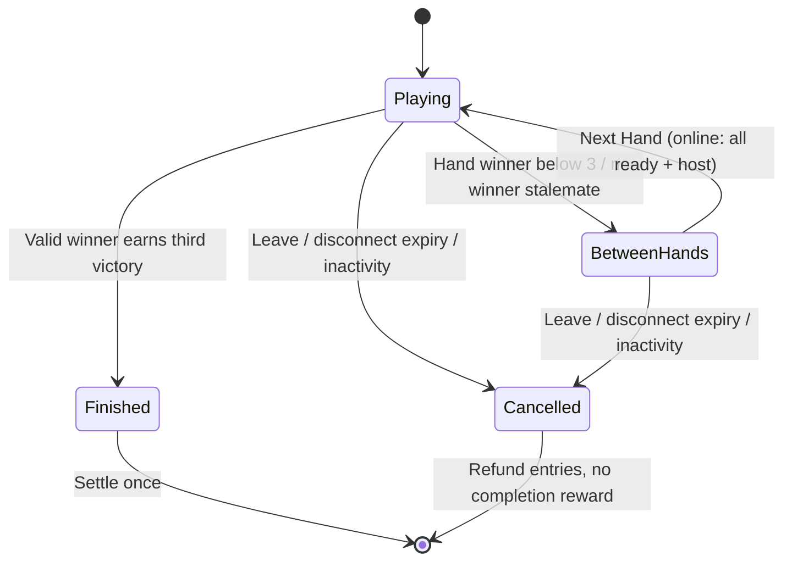

# Build 004B rule and state decisions

## One championship, several authoritative hands

`Championship` is public metadata: ID, target 3, current hand number, roster standings, dealer/starter indices, completed hand receipts and status. `GameState` remains the private authoritative hand, including draw order, hands, direction and pending action. `ChampionshipState` pairs them in the shared engine; the room stores the same metadata and current game in its durable record. Public snapshots contain championship metadata plus `playerView(game, viewer)` only.

`createChampionship` deals hand 1 with dealer at the last seat and starter at seat 0. Five rounds of single-card dealing begin at the starter. `applyChampionshipAction` delegates validation/action resolution to the existing hand engine, then records a finished hand exactly once. A valid winner adds one marker. Three markers set match status `finished`; otherwise status becomes `between-hands`. `nextChampionshipHand` only accepts that state, rotates dealer/starter clockwise, resets TAP/direction and deals under a unique `<match-id>:hand:<number>` ID. `cancelChampionship` is a distinct terminal state without a champion or match rewards. A championship rematch uses a new UUID and starts with zero markers.

A no-winner stalemate consumes a numbered deal but gives no marker. The next numbered deal rotates dealer/starter. The match and entry reservation continue. There is no false draw champion or per-hand prize.

## Turn completion and effect order

| Situation | Authority resolves |
|---|---|
| Starting Active Card is 2/8/10 | Normal matching only; no pending effect |
| Traditional opening match, cards remain | Record its pending action; remain in discard phase |
| Optional Traditional discard | Replace pending action with the discard's action (or none), then finalise |
| End after opening match | Finalise the opening card's pending action |
| Completed Chains move | Validate entire sequence first, play it atomically, finalise only its last card |
| Blocked one-card draw | Draw and end turn with no action from the Active Card |
| Empty hand + eligible TAP | Confirm hand winner immediately; clear pending action; do not penalise another player |
| Empty hand + invalid/missing TAP | Take one TAP penalty; if available, finalise final-card action, then advance once |
| No TAP penalty card available | Preserve prior no-winner stalemate; no winner or subsequent action |

A final 2 draws up to two into the next seat's private hand, including recycling that preserves the Active Card, then skips that seat even if cards are short. The shortage appears in a public event without identifying drawn cards. A final 8 skips the next seat. Both move two directional positions in one transition. No response or stacking window exists. A final 10 flips direction before selecting the next seat.

**Two-player Reverse interpretation for owner review:** direction flips, then the opponent plays. It does not grant an immediate extra turn. Draw Two and Skip still skip the opponent, so the acting player can be next in those two cases.

Turn numbers remain monotonic. Skipped positions advance the turn counter but do not erase any TAP declaration. The returning seat's next actual turn can use an earlier declaration. A confirmed action-card victory never applies its effect to opponents.

## Bots

Bots see only their private `PlayerView`, including public counts and direction. They declare TAP early, avoid going out before it is eligible when a legal alternative exists, and honour the exact same validation. A bounded 2,500-node chain search scores legal stopping points, prioritises emptying a TAP-eligible hand, and values disruptive final 2/8/10 plays when the next opponent is nearly out. Traditional bots may End turn to preserve a useful pending action rather than burying it with a normal discard. New hands reset declarations and continue with the same roster. The engine rejects moves after any hand or match terminal state.

## Online transactions and migration

The existing room serial queue, SQLite writes, hibernating sockets, request receipts, wallet reservations, permanent result ledger and durable recovery alarms remain in use. An online action includes championship ID, hand ID and revision. Between-hand readiness and Next Hand bind to both championship and completed-hand ID; late commands cannot start a later deal. A duplicate request ID with the same payload returns current state/ack, without replaying the transition. The host can start Next Hand only when every seat is present, connected and freshly ready.

Entry acceptance and reservation occur once before hand 1. Intermediate results update durable scores and clear readiness, but keep acceptance and committed chips. `settleChampionship` accepts only a finished championship with three recorded wins and a matching final hand; a permanent `result:<championship-id>` ledger row gates reward/pool changes. The existing legacy settlement method remains solely for old pending result recovery and historical regression checks. No public HTTP/socket endpoint accepts a result or balance.

Cancellation during play or between hands refunds the championship reservation and gives no completion prize. The same two-minute grace and 30-minute idle alarm cover both states. Local championships remain session-only; online metadata/game state survive restart/reconnect. Profile v1 remains compatible. New optional match counters initialise to zero; old aggregate statistics, balances and receipts remain unchanged.

Room JSON schema 2 distinguishes the new contract. Old active single-hand contracts cancel/refund on waking; old lobby acceptance/readiness is cleared before a championship can start. Old already-settled results remain historical and pending settlements recover through their old ledger IDs. This avoids moving an existing entry into different rules without agreement.

No Cloudflare provisioning, SQL namespace migration, push or deployment was performed.
